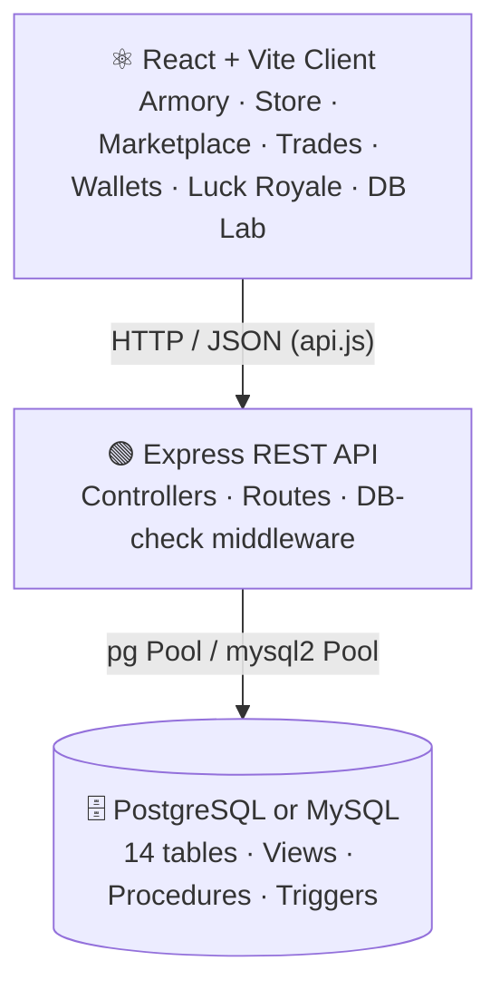

<div align="center">

# 🛡️ BLACKSITE // OPERATOR ARMORY

**A full-stack game inventory, marketplace & trading management system — built as a DBMS capstone project**


[Overview](#-overview) • [Features](#-features) • [Tech Stack](#-tech-stack) • [Architecture](#-architecture) • [Database](#-database-design) • [Setup](#-getting-started) • [API](#-api-reference) • [Documentation](#-documentation) • [Team](#-team)

</div>

---

## 📋 Overview

**BLACKSITE // OPERATOR ARMORY** is a tactical-themed web platform where players manage an armory of virtual gear, buy from a supply depot, trade peer-to-peer, and gamble on a limited-supply reward wheel — all backed by a fully normalized relational database.

The project was built to satisfy the official **DBMS Project Guidelines**: a documented ER diagram, a 3NF schema, 100+ seed records, and complete coverage of DDL, DML, DCL, TCL, joins, set operations, subqueries, views, procedures, functions and triggers.

### Highlights

- ✅ **Multi-engine database** — runs on PostgreSQL *or* MySQL/XAMPP, auto-detected at startup
- ✅ **ACID-safe economy** — purchases, listings and trades run inside transactions with row locking
- ✅ **14 normalized tables** (3NF) with constraints, indexes, views, procedures, functions and triggers
- ✅ **Interactive Database Lab** — run the full academic SQL syllabus from inside the app
- ✅ **Audit trail** — every sensitive action is logged to an immutable ledger
- ✅ **Live DB status banner** — the UI degrades gracefully when the database is offline

---

## ✨ Features

| Module | What it does |
|---|---|
| 🎖️ **Armory Inventory** | View owned item instances, equip/unequip gear, repair durability |
| 📖 **Item Catalog** | Master list of item archetypes with rarity, category and base durability |
| 🏪 **Supply Depot** | Store offers with price, currency, and limited stock |
| 💱 **P2P Marketplace** | List items for sale, cancel listings, buy from other players |
| 🤝 **Bilateral Trades** | Offer items + currency to another player; accept, decline or cancel |
| 💰 **Wallets** | Multi-currency balances, funding, and transaction history |
| 🎰 **Luck Royale** | Scarcity-based reward wheel with admin-configurable rewards and events |
| 👤 **Player Profile** | Operator stats, equipped gear and account status |
| 📊 **Dashboards** | Player command dashboard and an admin metrics dashboard |
| 🧾 **Audit Logs** | Immutable record of player and system actions |
| 🧪 **Database Lab** | Execute categorized DDL / DML / DCL / TCL / DQL demos live |

---

## 🛠️ Tech Stack

| Layer | Technologies |
|---|---|
| **Frontend** | React 18, Vite 5, Lucide React, custom tactical CSS theme |
| **Backend** | Node.js, Express 4, CORS, dotenv |
| **Database** | PostgreSQL 14+ (`pg`) **or** MySQL / MariaDB via XAMPP (`mysql2`) |
| **Reporting** | `docx` (auto-generated system report) |
| **Tooling** | `concurrently` for one-command dev startup |

---

## 🏗️ Architecture



The server probes the configured database on startup (`DB_DIALECT=auto`), selects the active engine, and exposes its status at `GET /api/health`, which drives the status banner in the UI.

---

## 🗃️ Database Design

> 📐 **ER Diagram:** [**FINAL_ER.pdf**](./FINAL_ER.pdf)

### Tables (14)

| # | Table | Purpose |
|---|---|---|
| 1 | `players` | Registered operators |
| 2 | `currencies` | Currency denominations (standard / premium) |
| 3 | `wallets` | Per-player, per-currency balances — `UNIQUE(player_id, currency_id)` |
| 4 | `item_catalog` | Item archetypes (rarity, category, durability) |
| 5 | `inventories` | Owned item instances |
| 6 | `store_offers` | Supply-depot offers with stock limits |
| 7 | `market_listings` | P2P listings — one active listing per item instance |
| 8 | `trades` | Trade header — `initiator_id <> receiver_id` |
| 9 | `trade_items` | Items attached to a trade |
| 10 | `trade_currencies` | Currency amounts attached to a trade |
| 11 | `audit_logs` | Immutable action ledger |
| 12 | `wheel_events` | Luck Royale event configuration |
| 13 | `wheel_rewards` | Reward pool and supply limits |
| 14 | `wheel_spins` | Spin history |

### Database objects

| Object | File |
|---|---|
| Schema (DDL) — PostgreSQL | [`database/schema.sql`](./database/schema.sql) |
| Schema — MySQL / XAMPP | [`database/xampp-mysql-schema.sql`](./database/xampp-mysql-schema.sql) |
| Indexes | [`database/indexes.sql`](./database/indexes.sql) |
| Views | [`database/views.sql`](./database/views.sql) |
| Functions | [`database/functions.sql`](./database/functions.sql) |
| Stored procedures | [`database/procedures.sql`](./database/procedures.sql) |
| Triggers | [`database/triggers.sql`](./database/triggers.sql) |
| Seed data (100+ records) | [`database/seed.sql`](./database/seed.sql) · [`xampp-mysql-seed.sql`](./database/xampp-mysql-seed.sql) |
| Operational queries | [`database/queries.sql`](./database/queries.sql) |
| Academic syllabus suite | [`database/dbms-lab.sql`](./database/dbms-lab.sql) |
| DDL + 20 SQL queries | [`database/DDL_AND_20_SQL_QUERIES.sql`](./database/DDL_AND_20_SQL_QUERIES.sql) |

### Normalization (3NF)

- **1NF** — atomic attributes; repeating groups (trade items, trade currencies) live in associative tables.
- **2NF** — no partial dependencies on composite keys.
- **3NF** — no transitive dependencies; item archetypes are separated from item instances.

Full proof: [`docs/database-design.md`](./docs/database-design.md)

---

## 🚀 Getting Started

### Prerequisites

- **Node.js** 18 or later
- **One** database engine: **PostgreSQL 14+** *or* **XAMPP** (MySQL/MariaDB)
- Git

### 1. Clone & install

```bash
git clone https://github.com/IshanPatel1912/Blacksite.git
cd Blacksite
npm run install:all
```

### 2. Configure environment

```bash
cp server/.env.example server/.env
```

```env
PORT=5001
DB_DIALECT=auto            # auto | postgres | mysql

# PostgreSQL
PGHOST=localhost
PGPORT=5432
PGDATABASE=blacksite_armory
PGUSER=postgres
PGPASSWORD=your_password

# MySQL / XAMPP
MYSQL_HOST=localhost
MYSQL_PORT=3306
MYSQL_DATABASE=blacksite_armory
MYSQL_USER=root
MYSQL_PASSWORD=

CLIENT_URL=http://localhost:5173
```

### 3. Initialize the database

<details open>
<summary><b>Option A — XAMPP (MySQL / MariaDB)</b></summary>

1. Open the XAMPP Control Panel and start **MySQL** (port `3306`).
2. From the project root:
   ```bash
   npm run db:setup:xampp
   ```
   This creates `blacksite_armory`, applies the schema and loads the seed data.
3. *(Optional)* Inspect the tables at `http://localhost/phpmyadmin`.
</details>

<details>
<summary><b>Option B — PostgreSQL</b></summary>

1. Make sure PostgreSQL is running on port `5432` and the credentials in `server/.env` are correct.
2. From the project root:
   ```bash
   npm run db:setup
   ```
</details>

### 4. Run the app

```bash
npm run dev
```

| Service | URL |
|---|---|
| Frontend | http://localhost:5173 |
| Backend API | http://localhost:5001/api |
| Health check | http://localhost:5001/api/health |

The top bar shows the active engine, e.g. `DB: ONLINE [mysql (XAMPP)]` or `DB: ONLINE [postgres]`.

### Useful scripts

| Command | Description |
|---|---|
| `npm run dev` | Start server + client together |
| `npm run server` / `npm run server:dev` | Backend only (`:dev` watches for changes) |
| `npm run client` | Frontend only |
| `npm run client:build` | Production build of the frontend |
| `npm run db:setup` | Initialize PostgreSQL |
| `npm run db:setup:xampp` | Initialize XAMPP MySQL |
| `npm run test:wheel` | Run the Luck Royale scarcity test |

---

## 📁 Project Structure

```
Blacksite/
├── client/                         # React + Vite frontend
│   ├── public/images/              # Item and operator artwork
│   └── src/
│       ├── components/
│       │   ├── common/             # ItemVisual
│       │   ├── layout/             # TopBar, Sidebar, DbStatusBanner, NotificationToast
│       │   ├── modals/             # ItemInspect, CreateListing, CreateTrade
│       │   └── operator/           # OperatorShowcase
│       ├── context/                # PlayerContext, NotificationContext
│       ├── pages/                  # 13 screens (Dashboard, Marketplace, Trades, ...)
│       ├── services/api.js         # Central API client
│       └── styles/                 # Global + theme CSS
│
├── server/                         # Express REST API
│   └── src/
│       ├── config/db.js            # PostgreSQL / MySQL pools + engine detection
│       ├── controllers/            # Business logic per module
│       ├── middleware/dbCheck.js   # Blocks requests when DB is offline
│       ├── routes/                 # api.js, wheelRoutes.js
│       ├── scripts/                # DB setup, 20-query runner, report generator
│       └── index.js
│
├── database/                       # All SQL: schema, seed, views, procedures, triggers, lab
├── docs/                           # Design docs + generated system report
├── FINAL_ER.pdf                    # ER diagram
├── Final Report.pdf                # Final project report
└── package.json                    # Root scripts (concurrently)
```

---

## 📚 API Reference

Base URL: `http://localhost:5001/api`

| Module | Method | Endpoint | Description |
|---|---|---|---|
| Health | GET | `/health` | Database connection status |
| Players | GET | `/players` · `/players/:id` | List / fetch players |
| | POST | `/players/:id/status` | Update player status |
| Dashboard | GET | `/dashboard` · `/admin/metrics` | Player & admin metrics |
| Wallets | GET | `/currencies` · `/wallets` · `/wallets/transactions` | Currencies, balances, history |
| | POST | `/wallets/fund` | Add funds |
| Inventory | GET | `/inventory` | Owned items |
| | POST | `/inventory/equip` · `/inventory/repair` | Equip toggle, repair |
| Catalog | GET / POST | `/catalog` | List / create item types |
| Store | GET / POST | `/store` | List / create offers |
| | PUT | `/store/:id` | Restock an offer |
| | POST | `/store/purchase` | Buy from the depot |
| Marketplace | GET | `/marketplace` | Active listings |
| | POST | `/marketplace/list` · `/cancel` · `/buy` | Create, cancel, buy |
| Trades | GET / POST | `/trades` | List / create trades |
| | POST | `/trades/:id/accept` · `/decline` · `/cancel` | Resolve a trade |
| Audit | GET | `/audit-logs` | Action ledger |
| DB Lab | GET | `/db-lab/categories` | Lab categories |
| | POST | `/db-lab/execute` | Run a lab query |
| Luck Royale | GET | `/wheel/state` | Current wheel state |
| | POST | `/wheel/spin` | Spin the wheel |
| | GET / POST | `/wheel/admin/config` · `/admin/reward/:id` · `/admin/event` · `/admin/history` | Admin controls |

---

## 🧪 Database Lab

The **Database Lab** page runs the course syllabus live against your database:

`DDL` · `DML` · `DCL` · `TCL` · `DQL` · `Clauses` · `GROUP BY / HAVING` · `Joins (all 6)` · `Set Operations` · `Subqueries` · `Views` · `Procedures / Functions / Triggers`

The same queries are available as plain SQL in [`database/dbms-lab.sql`](./database/dbms-lab.sql).

---

## 📄 Documentation

| Document | Description |
|---|---|
| 📐 [ER Diagram (PDF)](./FINAL_ER.pdf) | Entity-relationship diagram |
| 📘 [Final Report (PDF)](./Final%20Report.pdf) | Complete project report |
| 📝 [Project Analysis](./docs/project-analysis.md) | Purpose, roles, use cases |
| 🔗 [ERD Assumptions](./docs/erd-assumptions.md) | Entity / relationship mapping |
| 🧱 [Database Design](./docs/database-design.md) | 3NF proof & concurrency strategy |
| 🔍 [DDL & 20 Queries Guide](./docs/DDL_AND_20_QUERIES_GUIDE.md) | Walkthrough of the SQL deliverables |
| 📑 [System Report (DOCX)](./docs/BLACKSITE_ARMORY_SYSTEM_REPORT.docx) | Auto-generated system report |

---

## ✅ Academic Requirements Checklist

| Requirement | Status | Location |
|---|:---:|---|
| Project statement & use cases | ✅ | `docs/project-analysis.md` |
| ER diagram & cardinalities | ✅ | `FINAL_ER.pdf`, `docs/erd-assumptions.md` |
| Relational model & constraints | ✅ | `database/schema.sql` |
| 3NF normalization | ✅ | `docs/database-design.md` |
| 100+ seed records | ✅ | `database/seed.sql` |
| DDL / DML / DCL / TCL | ✅ | `database/dbms-lab.sql` |
| DQL, clauses, grouping | ✅ | `database/dbms-lab.sql` |
| Joins, set operations, subqueries | ✅ | `database/dbms-lab.sql` |
| Views | ✅ | `database/views.sql` |
| Procedures, functions, triggers | ✅ | `database/procedures.sql`, `functions.sql`, `triggers.sql` |
| Final report | ✅ | `Final Report.pdf` |

---

## 🩺 Troubleshooting

| Problem | Fix |
|---|---|
| **"Database disconnected" banner** | Start PostgreSQL / XAMPP MySQL and verify the credentials in `server/.env` |
| **Port already in use** | Change `PORT` in `server/.env` or the Vite port in `client/vite.config.js` |
| **Wrong engine detected** | Set `DB_DIALECT=postgres` or `DB_DIALECT=mysql` explicitly |
| **Empty tables** | Re-run `npm run db:setup` (or `db:setup:xampp`) |

---

## 👥 Team

This is a group project built by a team of four.

<div align="center">

| Member | Role | Responsibilities |
|:---:|:---:|---|
| **Ishan** | 💻 Frontend & Project Lead | React client, UI/UX, API integration, project integration |
| **Nishka** | 🗄️ Database | ER design, schema, normalization, SQL scripts, seed data |
| **Netraa** | 🔌 Server & DB Connectivity | Express server, database connection layer, API ↔ database integration |
| **Dhanya** | 📚 Documentation | Project report, design documents, ER documentation |

</div>

---

## 📜 License

Developed for academic purposes as part of a DBMS course project.

<div align="center">

**Made with ❤️ by Team Blacksite**

[🔝 Back to top](#️-blacksite--operator-armory)

</div>